<p align="center">
  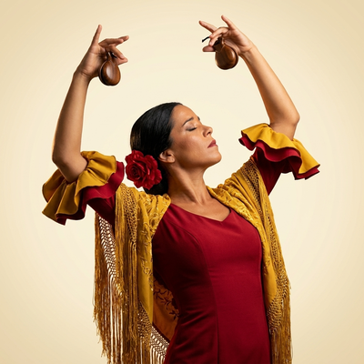
</p>

<h1 align="center">Conjugar</h1>

**Conjugar** is an iOS™ app for learning Spanish verb conjugations. **Conjugar** conjugates 4,811 verbs, regular and irregular, in _all_ Spanish verb tenses: the eleven simple tenses, the nine compound tenses, and the non-finite forms.

**Conjugar** is available for free download in the iOS App Store™. Tap the button below to install.

<p align="center">
  <a href="https://apps.apple.com/us/app/conjugar/id1236500467"></a>
</p>

Alternatively, you can clone this repo and build **Conjugar** yourself.

I released **Conjugar** in 2017 as a UIKit app with programmatic layout, and I wrote tutorials about the two techniques it was built to demonstrate: [dependency injection](https://racecondition.software/blog/dependency-injection/) and [programmatic layout](https://racecondition.software/blog/programmatic-layout/). The dependency-injection pattern survives; every external service still arrives through the `World` container described in that post. The programmatic layout does not. In 2026 I rewrote the app in SwiftUI, replaced the original conjugation engine with a rule-composition engine, and added the features below. No `UIViewController` subclass remains.

### Features

#### Look Up

- **Verb browser**: all 4,811 verbs, sorted by frequency of use or alphabetically. Every verb carries a frequency rank derived from the Real Academia Española's CORPES XXI corpus, from `ser` at #1 to the rarest at #4,811. A third list, My Verbs, holds the verbs you have starred and the ones you opened recently.
- **Search that finds what you type**: an infinitive, an English meaning, or any conjugated form. Type *fue* and the app finds both `ser` and `ir`, each with the tense and person that *fue* is. Search forgives a missing accent or *ñ*, offers a guess when nothing matches, and opens with Command-F on iPad and Mac.
- **Verb pages**: every tense of a verb, ordered by how much Spanish uses it, each under its other names with a link to its article. The irregular part of each form is picked out in red, so the shape of an irregularity is visible at a glance. Many verbs also carry an etymology, a modern example sentence, and an attestation from Medieval Spanish. Tap a form to hear it spoken, or long-press it to copy it. Related verbs, those built on the same root and those conjugated alike, sit at the bottom of the page, and the share button sends a verb's key forms.
- **A review card**: an irregular verb you looked up comes back on the Verbs tab when its key forms are due, so a lookup turns into practice.
- **Verb models**: the 102 conjugation patterns that the verbs inherit from, ranked by how irregular they are, each with a pronoun-by-tense grid and the list of verbs that follow it. A model with more than one verb has practice of its own.
- **Collections**: the 100 most frequent verbs, the *-go* verbs, the strong preterites, the irregular futures, and the irregular participles. Each shows how many of its verbs you have looked up, starts a quiz on itself, and can be shared as a link.
- **Reference**: an explanation of each Spanish tense, when to use it, and how it is formed, plus essays on terminology, *voseo*, the history of the Spanish verb system, and the two everyday constructions that are not tenses, *ir a* + infinitive and *estar* + gerundio.

#### Practice

- **Quiz**: rounds of ten questions, with ten more on request, at four levels. Each level asks the tenses of the one before and more, over a wider band of verbs: the 100 most used at Beginner, then 300 and 1,000, then every verb at Advanced. A slip such as a dropped accent earns a second try, and a missed question comes back a few questions later and again on a later day. From the second level up, each round asks which of two tenses a speaker would use (*jugaba* or *jugó*) and says why.
- **Choose what to practice**: all verbs, My Verbs, or a custom quiz over the tenses and verbs you choose, which a teacher can share with a class as a link or a QR code.
- **Exercises**: Verb Essentials asks irregular verbs' key forms (*tengo · tuve · tendré · tenido*), five verbs at a time. Verb Models practices one model's verbs and then mixes them with the models you know. Name the Form shows a form such as *fuera* and asks for its verb, tense, and person. Complete the Sentence asks for the verb missing from a short sentence. A Speed Round gives 60 seconds on what you have mastered.
- **Every day**: a daily session of ten questions, starting with what is due for review, that builds a streak. Two sessions the next day repair a missed day, and an optional reminder can nudge you. A daily challenge of five questions is the same for everyone at a level that day, and you can share how you did.
- **Review and progress**: a review of what has come due, practice of the questions you last missed, and a Mastery page that shows which regular patterns and irregular verbs your practice has made secure at your level.
- **Results and records**: a verb's example sentence after a right answer, an optional clock, a Live Activity with Dynamic Island support, a personal best at each level, and Game Center™ leaderboards, one per level, with achievements for mastering a level's regular patterns and the most used irregular verbs.

#### Everywhere Else

- **AI tutor**: answers Spanish-conjugation questions on-device, powered by Apple's Foundation Models and grounded in the app's own conjugation engine, so it cannot invent forms. Requires Apple Intelligence.
- **Widgets and controls**: a "Verb of the Day" and a tappable daily quiz, the first question of the daily challenge, on the Home Screen and Lock Screen. Three Control Center controls start a quiz, open a random verb, or open the search, and a quick action on the app icon opens the search too.
- **Siri, Shortcuts, and Spotlight**: "Look up a verb with Conjugar" answers with a verb's key forms or with the verbs a conjugation belongs to. Shortcuts also start a quiz or open a random verb, and Spotlight finds verbs.
- **Regional settings**: Spain or Latin America, and *tú* or *vos*, affecting which forms the quiz asks for, which forms the browser shows, and the accent in which the app pronounces conjugations aloud.
- **Retro arcade minigame**, *Toreo por Amor*, reachable from Settings: a five-stage climb followed by a flamenco dance-off against the bull.
- **Alternate app icons**: dancer, bull, matador, or the classic 2017 icon.
- **English and Spanish** localization throughout, on iPhone and iPad.

### Screenshots

| Verb List | Search | Verb | Verb-Model List | Verb Model |
| --- | --- | --- | --- | --- |
| 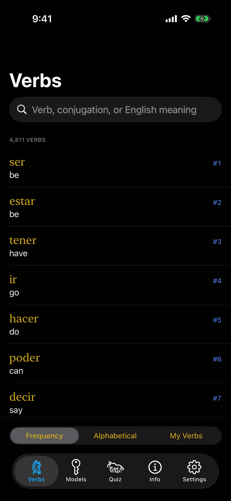 | 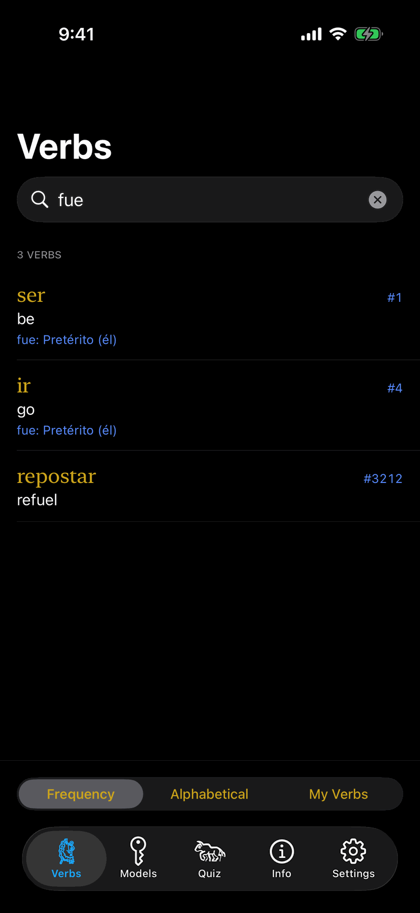 | 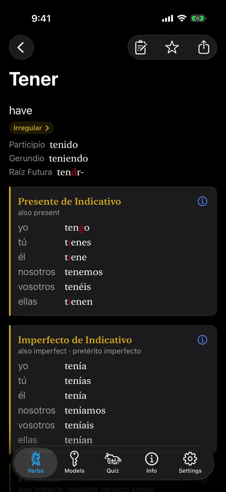 | 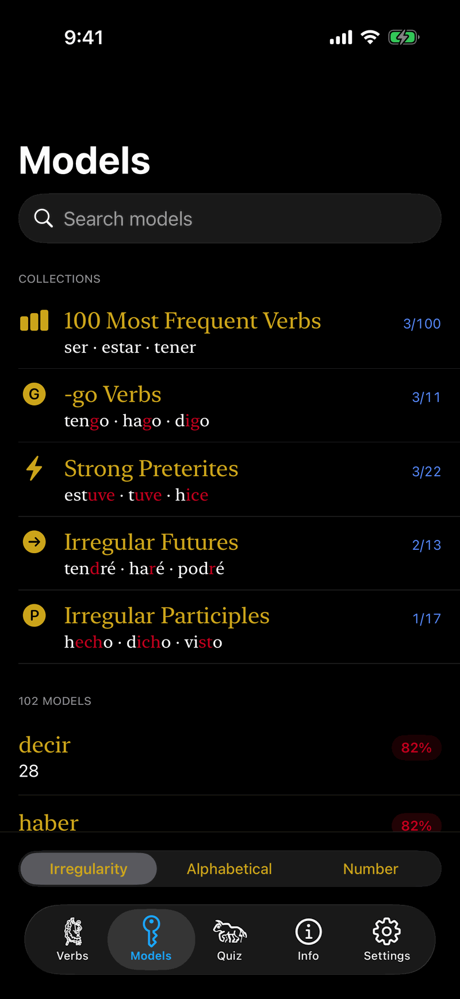 | 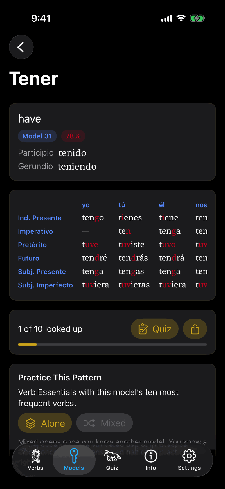 |

| Exercises | Quiz | Quiz Results | Verb Essentials | Name the Form |
| --- | --- | --- | --- | --- |
| 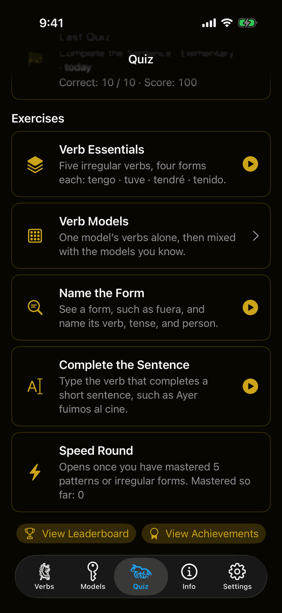 | 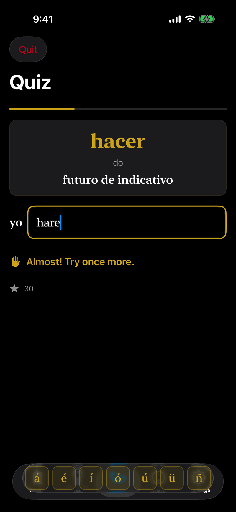 | 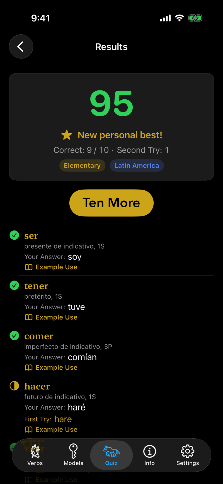 | 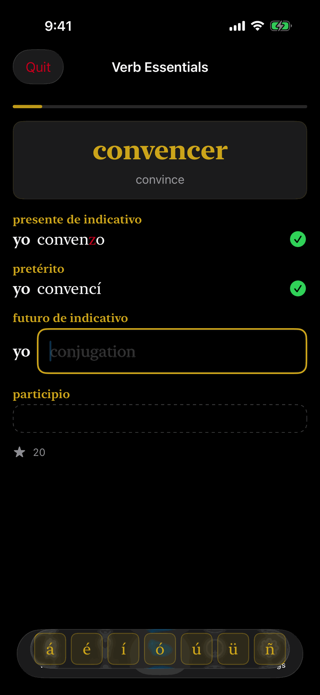 | 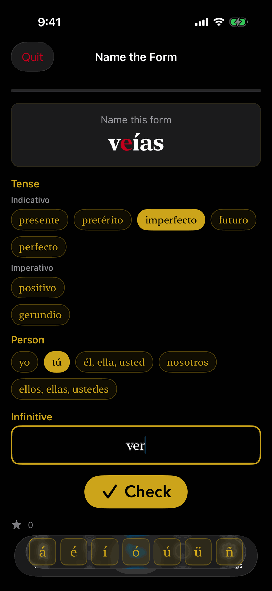 |

| Complete the Sentence | Info List | Tense Description | Settings | Minigame |
| --- | --- | --- | --- | --- |
| 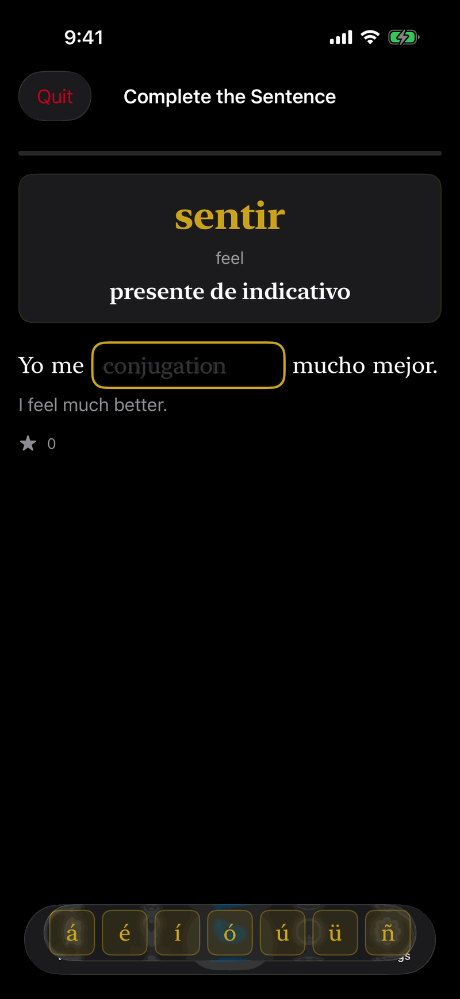 | 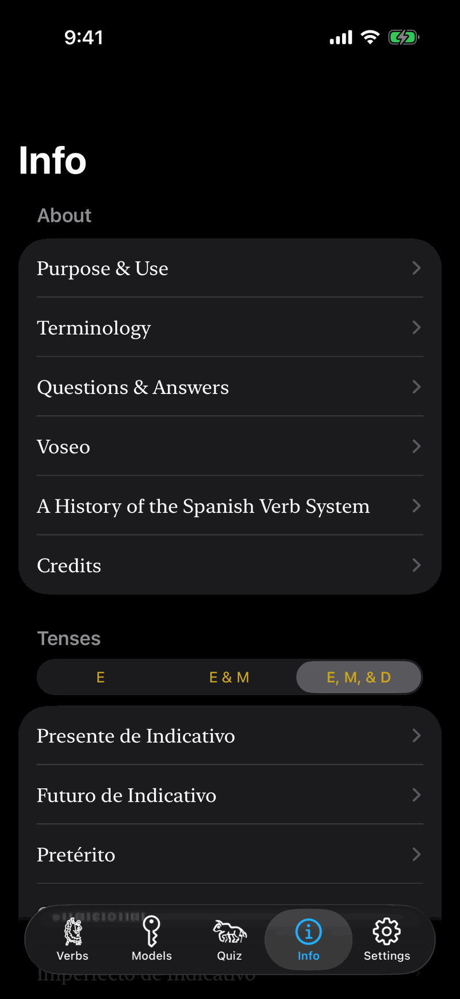 | 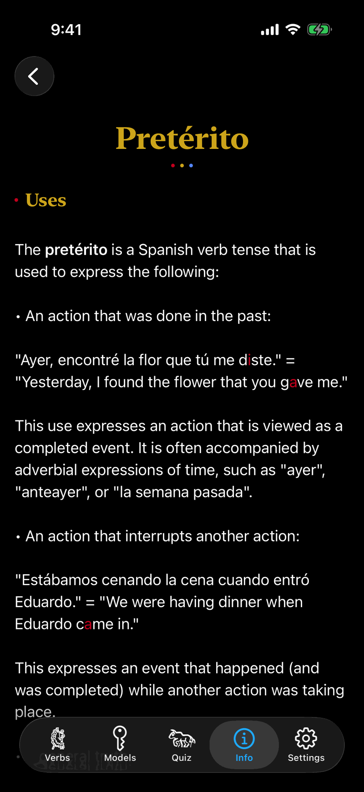 | 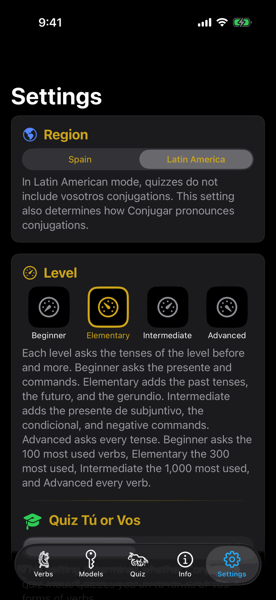 | 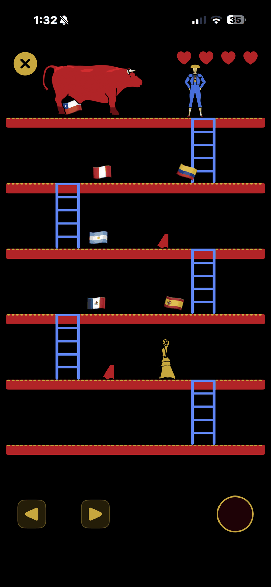 |

### Building from Source

**Conjugar** targets iOS 26 and builds with Swift 6. Open `Conjugar.xcodeproj` in Xcode™ and build the
`Conjugar` scheme.

Before your first build, create the gitignored `Conjugar/Secrets.xcconfig` from its template. It holds
the analytics ([TelemetryDeck](https://telemetrydeck.com)) app ID, which is not checked in:

```bash
cp Conjugar/Secrets.example.xcconfig Conjugar/Secrets.xcconfig
```

Then fill in your own `TELEMETRY_DECK_APP_ID` (or leave the placeholder; the app builds and runs
either way, and analytics simply go nowhere). **Conjugar** briefly used AWS Pinpoint for analytics years ago.
That integration is long gone, and no analytics backend, framework, or configuration file is required
to build the app.

Further documentation lives in [`docs/`](docs), starting with the annotated directory tree in
[`docs/project_structure.md`](docs/project_structure.md).

### Data sources

The verbs' frequency ranks are derived from the lemma-frequency lists of the Real Academia
Española's [CORPES XXI](https://www.rae.es/banco-de-datos/corpes-xxi) (version 1.5), published
under the [Creative Commons Attribution-ShareAlike 4.0](https://creativecommons.org/licenses/by-sa/4.0/)
licence; ties are ordered with verb counts from the
[Google Books Ngram](https://storage.googleapis.com/books/ngrams/books/datasetsv3.html) 2020
release, under [Creative Commons Attribution 3.0](https://creativecommons.org/licenses/by/3.0/).
Changes were made: pronominal lemmas are merged into their base verb, and a flagged estimate
stands in where CORPES has no lemma at all. The derived counts in
`Conjugar/Models/verbModelMap.xml` and `docs/frequencies.txt` are therefore shared under the same
Attribution-ShareAlike licence, separately from the app's AGPL. The pipeline that produces them,
with full provenance, is [`frequency/`](frequency).

The app's other content sources, among them Wikipedia, Project Gutenberg, government open-data
portals, and sound and art licensors, are credited on the Info tab's Credits screen and in
[`asset_licenses/`](asset_licenses).

### License

If **Conjugar** is in the App Store, why is the code on GitHub? I created this app to demonstrate programmatic layout for a conference talk, and I wished to provide helpful example code for folks who were curious about that technique. I originally released **Conjugar**'s source code under the MIT License because that license is maximally convenient for would-be users of the code. This was a mistake. Some dirtbag released a _clone_ of **Conjugar** on the App Store that differed only in that it had a hideous app icon, that it requested push-notification permission, and that it crashed on launch. I have changed the MIT License to the GNU Affero General Public License in order to impose onerous requirements on would-be cloners of **Conjugar**.
